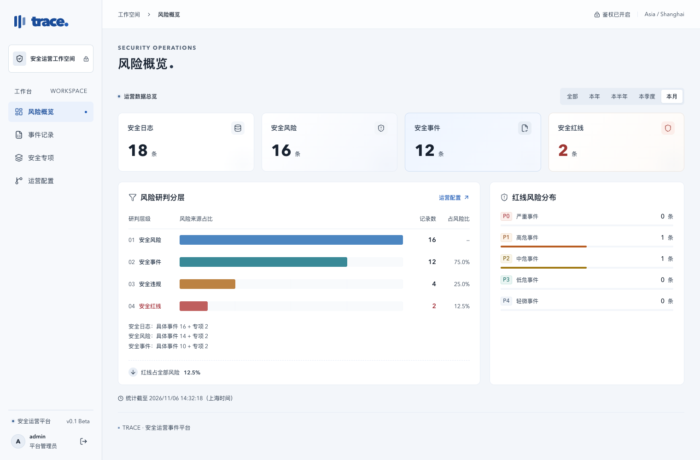
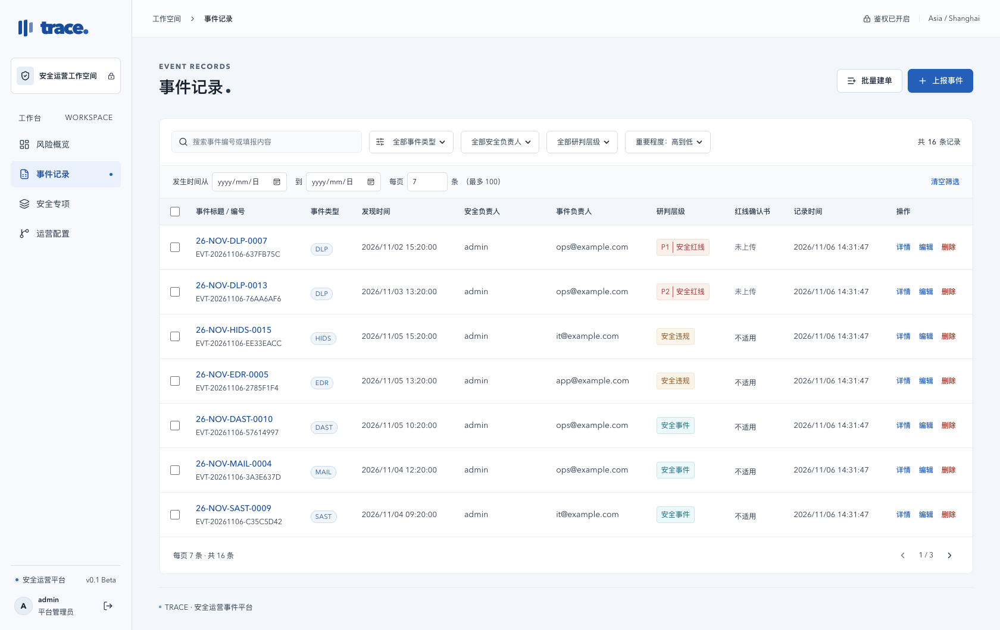
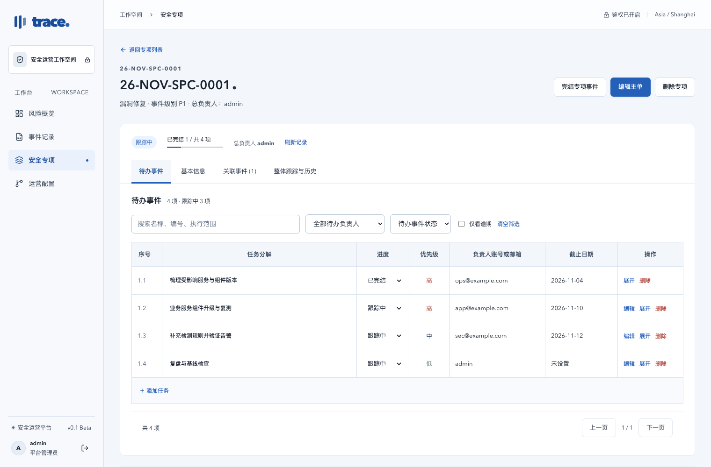

# Trace · 安全运营事件记录平台

**面向安全工作者的日常事件运营记录平台，用于记录安全运营的工作过程数据。**

把告警核查、风险研判、应急处置和专项整改中的发现、判断、负责人、证据与后续进展集中保存，方便日常跟进、工作交接和复盘统计。

支持具体事件记录和跨团队安全专项：事件单独建档，专项按任务推进，两者可以关联，并在本地风险概览中汇总。

`v0.1 Beta` · 自托管 · 中文界面 · SQLite · MIT

Self-hosted security operations worklog for daily events, investigation evidence, remediation campaigns, and local analytics.



*截图均来自独立演示环境，内容及负责人为虚构数据；首次启动为空白工作空间。*

## 适合哪些工作

- **日常值班**：登记 DLP、EDR、HIDS、WAF、邮件等来源的安全发现，保存核查过程与研判结论。
- **应急处置**：记录异常行为、影响范围、处置动作和证据，关联正在推进的排查或修复专项。
- **专项整改**：面向全公司、某条业务线或一类服务开展统一排查，把工作拆成由不同负责人跟进的待办。
- **运营复盘**：按周期查看日志、风险、事件、违规及红线数量，回顾事件与专项的处理过程。

## 功能一览

| 模块 | 支持内容 |
| --- | --- |
| 事件记录 | 手动上报、编辑、搜索、类型及负责人筛选、发现时间筛选、排序、分页、删除 |
| 风险研判 | 安全风险 → 安全事件 → 安全违规 → 安全红线逐级判定，红线事件 P0–P4 分级 |
| 批量建单 | 逐行填写、下载与导入 XLSX 模板，每批最多 100 条，每行生成独立事件 |
| 安全专项 | 总负责人、目标范围、P0–P4 事件级别、起止时间区间、可新增／改名／删除的类型标签 |
| 待办事件 | 表格逐项管理、负责人、优先级、选填截止日期、跟踪／完结、明细、跟踪记录 |
| 事件关联 | 具体事件与专项双向引用，区分风险来源、事件后改进、相关排查及确认情况 |
| 证据附件 | 手动上传图片和文档、红线确认书、登录后下载、删除管理 |
| 风险概览 | 全部、本年、本半年、本季度、本月统计，研判漏斗、红线 P0–P4 分布 |
| 文本上报 API | 独立密钥、标签管理、启停控制、幂等重试，供脚本或其他系统提交单条事件 |

### 事件记录

一条记录保存发现时间、事件类型、安全负责人、事件负责人、逐级研判结果和详细内容。详情支持富文本与手动证据附件；红线记录可以上传确认书。

支持 DLP、EDR、HIDS、监管通报、人工反馈、RASP、WAF、SAST、DAST、MAIL、威胁情报等分类。所有分类均可独立使用，不需要连接对应厂商平台。



### 安全专项与待办

用主单统筹一项整体工作，例如组件漏洞修复、入侵应急改进、监管检查。主单确定总负责人、范围、级别和时间区间，具体工作按表格逐行分派。

每个待办有独立负责人、优先级、状态和选填截止日期。展开可查看明细与跟踪记录，主单另有基本信息、关联事件和整体历史。



## 快速开始

需要 **Node.js 22.13 或以上**及 npm。项目使用 Node.js 内置 SQLite，不需要另外安装数据库。

下载 [Beta Release 中的 ZIP 源码包](https://github.com/BreakTheEarth/secEventTracePlatform/releases)，解压后在项目目录打开终端：

```bash
npm ci
npm run build
npm start
```

浏览器访问 `http://127.0.0.1:3001`，本地体验账号：

```text
用户名：admin
密码：admin
```

首次运行自动创建 `.env` 和空数据库。停止服务可在启动终端按 `Ctrl+C`；再次执行 `npm start` 会保留已有记录。

开发模式使用 `npm run dev`，无需提前构建。端口冲突时修改 `.env` 中的 `PORT`。

## 第一次使用

### 1. 记录一条具体事件

进入 **事件记录 → 上报事件**，选择类型和发现时间，填写双方负责人，逐级完成风险研判，再记录发现、核查和处置内容。保存后可打开详情补充附件。

只有达到安全红线层级时才填写红线 P0–P4，P0 最高。安全负责人默认 `admin`；负责人字段支持 `admin` 或有效邮箱，可填写多名负责人。

批量登记时，进入 **批量建单 → 下载 XLSX 模板**，按模板逐行填写完整字段，导入并检查后统一提交。每行创建独立事件，附件在创建后逐条补充。

### 2. 发起一个安全专项

进入 **安全专项 → 新建专项事件**，填写总负责人、类型、P0–P4 事件级别、目标范围和详细内容，选择“发现时间 → 计划完成时间”区间。

可以直接逐行添加待办，也可以保存主单后在执行清单底部点击 **添加任务**。子待办的截止日期和明细均选填，日期独立设置，不继承主单时间。

跟进过程中补充记录，将任务改为已完结。所有待办完结后，手动完结主专项。需要继续处理时可重新打开；任务状态切换不要求填写备注。

### 3. 将具体事件与专项关联

例如：为某组件建立修复专项后，发现一台主机出现异常，可单独建立 HIDS 事件，再关联到该专项并注明核实情况。也可以先处置事件，再从事件详情发起事后改进专项。

事件与专项分别列表管理。关联用于追溯与跟进，不会自动确认因果，也不会额外增加统计。

### 4. 查看运营数据

进入 **风险概览**，切换全部、本年、本半年、本季度或本月，查看累计研判层级和红线分布。统计按发现时间归入周期，使用上海时间。

- 每条具体事件计入安全日志，并逐级累计到其研判层级。
- 每个有效专项计入安全日志 +1、安全风险 +1、安全事件 +1；完结后仍保留统计，删除后不再计入。
- 子待办不独立计数。专项 P0–P4 表示工作重要程度，不计入红线 P0–P4 分布。

## 可选：通过 API 登记事件

在 **运营配置 → 事件上报 API** 创建独立密钥并启用接口，使用 `POST /api/v1/events` 提交单条纯文本事件。附件通过页面手动上传。

支持 `Authorization: Bearer <API_KEY>` 和 `Idempotency-Key`，便于脚本接入与失败重试。完整字段、示例及返回码见 [API 调用说明](docs/skills/report-security-event/SKILL.md)，页面也可下载这份说明。

## 部署与数据保存

正式使用前修改 `.env` 中的 `ADMIN_PASSWORD`。需要局域网访问时设置 `HOST=0.0.0.0`；通过 HTTPS 反向代理提供访问时设置 `COOKIE_SECURE=true`，并重新启动服务。

| 位置 | 内容 |
| --- | --- |
| `data/trace.sqlite` | 事件、专项、待办、历史、配置及本地统计 |
| `data/integrations/event-assets/` | 事件证据附件 |
| `data/integrations/campaign-assets/` | 专项与待办附件 |
| `data/integrations/reporting-api.key` | API 密钥的加密主密钥 |
| `.env` | 监听地址、管理员账号与运行配置 |

备份时停止服务，复制完整 `data/` 和 `.env`。数据库使用 WAL，运行中不要只复制单个 `.sqlite` 文件；加密主密钥需与数据库一起保留。更新程序前先备份，并保留原数据和配置。删除平台文件不会同步清除历史备份。

## Beta 版本范围

当前为单管理员工作空间，适合个人安全运营、值班台账和小团队统一维护记录。负责人字段代表业务分工，不会创建登录账号，也不提供员工权限隔离、SSO、审批或自动通知。

本版本保留本地统计与文本上报，未包含外部 Dashboard 推送、定时推送、外部日志查询、日志 ID 自动获取、自动下载证据或厂商专用连接。DLP 等名称仅作为通用事件分类。

公开源码及源码包不含业务记录、附件和真实配置。部署后请自行备份数据；详细边界见 [安全说明](SECURITY.md)。

## 开发与贡献

技术栈：React · Vite · Express · SQLite · ExcelJS · sanitize-html。

```bash
npm test
npm run build
npm run check:release
```

测试使用临时数据库，覆盖事件、批量导入、专项与待办、状态流转、关联、附件、统计和文本 API。GitHub Actions 配置在 Node.js 22、24 上运行测试与构建。

`npm run package:source` 生成 ZIP 源码包和 SHA-256 校验文件，包含文档及演示截图，排除本地数据、配置、依赖和运行日志。源码包不含 `dist/`，解压后按快速开始构建。

- [开发说明与接口](docs/DEVELOPMENT.md)
- [GitHub 发布步骤](docs/PUBLISHING.md)
- [贡献约定](CONTRIBUTING.md)
- [变更记录](CHANGELOG.md)

欢迎通过 Issue 反馈问题和使用建议，或通过 Pull Request 改进功能与文档。公开反馈请使用脱敏或虚构数据。

源码使用 [MIT License](LICENSE)，依赖保留各自许可证。

## Star History

[](https://www.star-history.com/#BreakTheEarth/secEventTracePlatform&Date)
